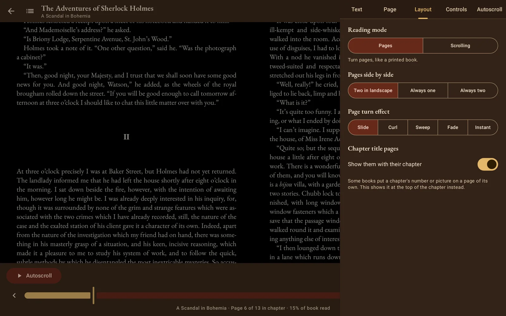

  

<h1 align="center">KoLib</h1>

  <b>Your ebook library for Kobo, on your Android tablet or phone.</b> 
  Keep your books in one place, send them to your Kobo over a USB-C cable, read them, and edit them.

  
  
  
  

  

## What KoLib does

**Keeps your books.** Add ebooks from your tablet or phone, one file or a whole folder at a time.
KoLib opens almost any ebook file, from EPUB and PDF to MOBI and Word, and comics too. Tidy up
titles, authors, series and tags, and give every book a good cover.

**Sends them to your Kobo.** Plug your Kobo in with a USB-C cable and KoLib shows the books and
collections on it. Send books across in the Kobo's own kepub format, so pages turn quickly and the
Kobo keeps your reading stats, and put them straight into your Kobo collections.

**Lets you read them.** A full reader for books, and a comic reader modelled on Mihon's, with your
choice of font and page colour, highlights, notes and bookmarks.

**Shares them between your devices.** Pair KoLib on your phone with KoLib on your tablet, then send
books, files and text from one to the other over your Wi-Fi, and pick up on one where you left off on
the other.

**Edits them, and makes new ones.** Fix typos, find and replace, and sort out chapters. Split an
omnibus into separate books or join books into one. Turn Word files, PDFs, text and comics into
EPUBs, or write a new book from scratch.

There's no account to make and no ads.

## On a tablet

<table>
  <tr>
    <td align="center" width="50%"> <b>The books on your Kobo</b></td>
    <td align="center" width="50%"> <b>Its collections</b></td>
  </tr>
  <tr>
    <td align="center" width="50%"> <b>Sending books</b></td>
    <td align="center" width="50%"> <b>Editing its details</b></td>
  </tr>
  <tr>
    <td align="center" width="50%"> <b>Changing a cover</b></td>
    <td align="center" width="50%"> <b>Making a new one</b></td>
  </tr>
  <tr>
    <td align="center" width="50%"> <b>Reading, two pages side by side</b></td>
    <td align="center" width="50%"> <b>The reader's settings</b></td>
  </tr>
  <tr>
    <td align="center" width="50%"> <b>Editing the text</b></td>
    <td align="center" width="50%"> <b>The light look</b></td>
  </tr>
</table>

## On a phone

<table>
  <tr>
    <td align="center" width="33%"> <b>Library</b></td>
    <td align="center" width="33%"> <b>A book's page</b></td>
    <td align="center" width="33%"> <b>Your Kobo</b></td>
  </tr>
  <tr>
    <td align="center" width="33%"> <b>Sending</b></td>
    <td align="center" width="33%"> <b>Reading</b></td>
    <td align="center" width="33%"> <b>Making a cover</b></td>
  </tr>
</table>

## Everything it can do

### Your library

- Add books one at a time, a whole folder at once, or straight from your Kobo.
- Open EPUB, kepub, PDF, MOBI, AZW and AZW3, FB2, Word (.docx), OpenDocument (.odt), RTF, plain
  text, Markdown and HTML files, and CBZ, CBR and CB7 comics. Each book is kept as an EPUB you can
  edit, along with the file you added.
- Edit titles, authors, series, tags, ratings and descriptions. In a book's details, tap its title,
  author or series to copy it, or hold it to search for it in KoLib or on the internet.
- Find a cover online (on Amazon, Google Books, Open Library or Google Images), use a picture of
  your own, or make one with the book's title. There are 25 designs, among them a framed picture, a
  full painting, gold-stamped cloth, a spell book, thorns and roses, neon, a pulp magazine, a poster,
  a snapshot, a wand, an owl and a raven. Pictures are painted for 47 genres, from epic fantasy, magic schools, dark magic and
  storm-swept epics to space opera, starship voyages, war, regency, dark romance, fluff and angst. The
  genre is guessed from the book's tags (fan fiction's fandoms and tags too), and you can swap the
  picture for one of your own, then move and zoom it. Pick from 32 colour schemes or a colour of
  your own, and choose the colours of the title and author, the series, and the lines and ornaments
  separately. A design with a picture can use the book's own cover, and the series number can be in
  words ("Book Six of"), in figures, left off ("Book of"), or "A book of".
- Search and sort your books, and filter them by tag.
- Make a PDF of scanned pages into a book whose text fits the screen: KoLib recognises the words in
  the pages on your device, in English, French, German, Spanish, Italian, Dutch, Portuguese,
  Russian, Japanese, Ancient or Modern Greek and Latin. The recognition data for each language is
  downloaded once, the first time it's used. The page behind showing through a thin scan is taken
  out before the words are read. Compare the text with the scanned pages side by side, and go back
  to the scan whenever you like.

### Your Kobo

- See every book and collection on your Kobo, and how far you've read, and filter the Kobo's books
  by whether they're in your library.
- Send books as kepubs (or plain EPUBs if you'd rather), with covers fitted to your Kobo's screen,
  whichever model it is. Send a book again and it's updated on the Kobo without losing your place.
- Put books into your Kobo collections as you send them. KoLib can't create collections on the
  Kobo, so make the collection there first (My Books → Collections → New collection).
- Copy books you put on the Kobo yourself into your library, or delete them from the Kobo.
- Each time you connect and the Kobo's database has changed, KoLib keeps a backup of it on your
  device before it changes anything. Updates to collections and book details write only the parts
  of the database that changed, so they're quick.

### Your phone and tablet together

- Pair KoLib on your phone with KoLib on your tablet in the Devices section. Both show the same
  six-figure code when you pair, so you know it's really them.
- Send books from one to the other with their details, covers and collections, and your highlights,
  bookmarks and place in them. A book the other already has isn't sent again; only your reading is
  brought across.
- Keep your place in books the same on both: whenever the two find each other, each book goes to
  wherever you read it to last.
- Send files to the other's Downloads folder, and text to its clipboard. From other apps, Share →
  Send to device does the same.
- It works on any Wi-Fi network, or with one device sharing its hotspot with the other. Everything
  goes straight between the two over your own network, encrypted, and only paired devices can send.
- KoLib needs to be open on both, unless you let it stay reachable when it's closed (it shows a
  notification while it is).

### Reading

- Turn pages like a printed book or scroll, one page at a time or two side by side.
- Choose the font, text size, line spacing, margins and page colour, including dark pages for
  reading at night.
- Pages laid out like a printed book: page headings and page numbers, chapters that start on a
  right-hand page, the chapter's number and title in print style, and a large first letter where a
  chapter of the story starts. Page numbers run through the whole book and stay the same every time
  you open it.
- Each book can keep a look of its own (font, layout, page headings and so on), or use the one you
  usually read with.
- Highlights, notes and bookmarks, search, autoscroll, and looking words up in your dictionary app.
- A page some books split into little files (a part's title, an ornament under it, its name) is put
  back together on one page, and an ornament on its own isn't blown up to fill the screen.
- Maps and pictures printed across two pages are shown whole. Full-page pictures fill the page out to
  the margins, and two in a row (a light novel's colour pages) go side by side. A picture printed on
  its side is found from the words in it (with the recognition data for the book's language on your
  device) and turned the right way up, across both pages; or tap a picture to turn it yourself.
- Every picture in the book in one place: the Pictures tab, beside the contents, bookmarks and
  highlights, shows them all small, in the order they come, each with its chapter (and its book, in
  a book of several). Tap one to see it full screen, swipe for the next or the one before, and go to
  its page if you like.
- Save any picture in a book to your device, or share it: from the picture shown full screen, or by
  holding it on the page.

### Comics

- Open CBZ, CBR and CB7 files of any size, even several gigabytes. Pages are read straight from the
  file.
- Read left to right, right to left (manga), top to bottom, or as one long strip.
- Fit pages to the screen, its width or its height, crop off the borders, split two-page spreads,
  and zoom by pinching or double-tapping.
- The comic reader is modelled on [Mihon](https://github.com/mihonapp/mihon)'s, so if you've used
  Mihon, it'll feel familiar.
- Comics go to your Kobo as CBZ or CBR files, which the Kobo opens itself.

### Editing books and making EPUBs

- Edit a book's text: fix typos, find and replace (with a mode for renaming a character), and tidy
  up blank lines, quotes and dashes.
- Rename, move, split and join chapters, and rebuild the contents from the chapter headings.
  Hold a chapter to select it (hold another to select everything between), then move or delete
  them all at once.
- Copy a section (a title page, a copyright page, a chapter) with its pictures and styles, and add it
  to any book from the Copied panel. Copied sections stay until you delete them. A copied contents
  page can keep its look and list the chapters of the book you add it to.
- Give a book a cover page: make one from its cover (or from a cover made for it, if it has none),
  or mark one of its pages as the cover.
- Split an omnibus into separate books, or combine several books into one. When splitting, every
  book can get the omnibus's opening and closing pages, with its contents page listing that book's
  own chapters.
- Turn Word, OpenDocument, PDF, MOBI, FB2, RTF, text, Markdown and HTML files, and comics, into
  EPUBs.
- Write a new book from scratch.
- Save any book as an EPUB or a kepub, to use in any other app.

### In your language

English, Français, Deutsch, Español, Italiano, Nederlands, Português (Brasil), Русский and 日本語.
KoLib follows your device's language, or you can pick one in its settings.

### Private

Your books, and everything you do with them, stay on your devices and your Kobo. KoLib only goes
online when you look for a cover or look a word up, and the first time you make a scanned book into
text in a language, to download that language's data from the Tesseract project on GitHub. The
pages themselves are read on your device and never sent anywhere. What you send between your own
devices goes straight from one to the other over your own network, encrypted, not over the internet.

## Install

1. Download the APK for your device from [Releases](https://github.com/Talilard1/KoLib/releases/latest).
   Not sure which one? Take **arm64-v8a**, or the universal one.
2. Open it, and allow installing apps from that source if Android asks.
3. Open KoLib. A short tour sets your language, finds your books and shows you how to connect your
   Kobo.

| File | Best for |
|---|---|
| **KoLib-…-arm64-v8a.apk** | **Almost every phone and tablet from the last several years** |
| KoLib-…-armeabi-v7a.apk | Older 32-bit phones and tablets |
| KoLib-…-x86_64.apk | Chromebooks, and Android emulators on a PC |
| KoLib-…-x86.apk | Older emulators |
| KoLib-…-universal.apk | If you are uncertain |

KoLib needs Android 10 or newer, and a USB-C cable (or adapter) that carries data, not only power.
New versions install over the one you have, and your library and settings stay as they are.

## Connecting your Kobo

1. Plug the Kobo into your tablet or phone with the cable.
2. On the Kobo's screen, tap **Connect**.
3. The first time only, Android asks which folder KoLib may use. It opens on the Kobo's drive, so
   tap **Use this folder**, then **Allow**.

Android takes a few seconds to open the Kobo's drive after you tap **Connect**. KoLib says it's
opening the Kobo in the meantime, so leave it plugged in.

When you're done, tap **Eject** in KoLib. It opens the Kobo's page in Android's settings, where you
tap **Unmount**, and then KoLib tells you it's safe to unplug the Kobo. If you unplug it without
unmounting it, Android may need restarting before the Kobo will connect again. Once it's unplugged,
the Kobo adds the books you sent to its library.

KoLib was made with a Kobo Clara 2E, a Galaxy Tab S9 and a Galaxy A72. Other Kobo e-readers keep
their books the same way, so they should work too. KoLib knows the screen size of every Kobo from
the Touch onwards and makes covers that size for the one you plug in.

## Something wrong?

KoLib keeps a log of what it does (Kobo → Device → Open log). Please share the log when you
[report a problem](https://github.com/Talilard1/KoLib/issues), and say which Kobo and device you have.

## Thanks

- **[Mihon](https://github.com/mihonapp/mihon):** KoLib's comic reader is modelled on Mihon's, from
  its reading modes and ways of fitting pages to its tap zones and zooming.
- **[kepubify](https://github.com/pgaskin/kepubify):** books are made into kepubs for the Kobo the
  way kepubify does it.
- **[libarchive](https://www.libarchive.org/)** and **[libarchive for Android](https://github.com/zhanghai/libarchive-android):**
  opening CBR and CB7 comics.
- **[Tesseract](https://github.com/tesseract-ocr/tesseract)** and **[Tesseract4Android](https://github.com/adaptech-cz/Tesseract4Android):**
  recognising the words in scanned pages.
- The fonts (EB Garamond, Literata, Atkinson Hyperlegible, OpenDyslexic, Lora, Poppins, Cinzel,
  UnifrakturMaguntia, Great Vibes, Bebas Neue, Orbitron, Poiret One, Fredoka and Liberation) and
  Android's own libraries. All of them, with their licences, are listed in
  [NOTICE.md](NOTICE.md).

## Building it yourself

How to build KoLib, run its tests and add translations is in [docs/BUILDING.md](docs/BUILDING.md).

## Licence

KoLib is free software: you can share it and change it under the GNU General Public License,
version 3 ([LICENSE](LICENSE)).

Kobo is a trademark of Rakuten Kobo Inc. KoLib isn't made by, endorsed by or connected with
Rakuten Kobo. The books in the pictures are public domain, with covers made from public-domain
paintings.
