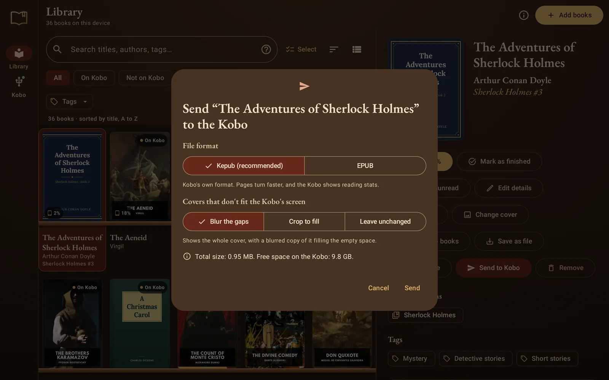
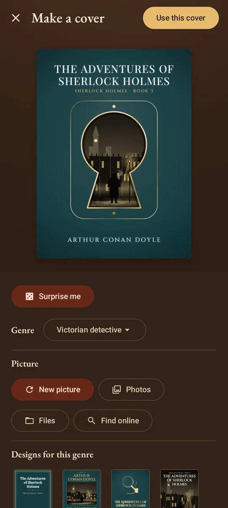

  

<h1 align="center">KoLib</h1>

  <b>An ebook library and Kobo manager for Android.</b> 
  Organise your books, send them to your Kobo, read them and edit them.

  
  
  
  

  

## Download

Get the latest APK from [Releases](https://github.com/Talilard1/KoLib/releases/latest).

| File | Best for |
|---|---|
| **KoLib-…-arm64-v8a.apk** | **Almost every phone and tablet from the last several years** |
| KoLib-…-armeabi-v7a.apk | Older 32-bit phones and tablets |
| KoLib-…-x86_64.apk | Chromebooks, and Android emulators on a PC |
| KoLib-…-x86.apk | Older emulators |
| KoLib-…-universal.apk | If you are uncertain |

*Requires Android 10 or higher. Sending over USB needs a USB-C data cable.*

## Features

- A library for EPUB, kepub, PDF, MOBI, AZW3, FB2, Word, OpenDocument, RTF, text, Markdown and HTML
  books, and CBZ, CBR and CB7 comics.
- Send books to a Kobo over USB as kepub or EPUB, straight into your Kobo collections, with covers
  sized for its screen.
- Send over Wi-Fi through the Kobo's web browser when there's no cable to hand.
- A configurable reader: fonts, page colours, paged or scrolling, two-page view, print-style
  layout, highlights, notes, bookmarks, dictionary lookup and autoscroll.
- A comic reader modelled on [Mihon](https://github.com/mihonapp/mihon)'s.
- Reading stats, including the reading time recorded by your Kobo.
- Edit titles, authors, series, tags and covers. Find covers online, or generate one from 123
  designs in 43 colour schemes.
- Edit a book's text: find and replace, chapter tools, clean-ups, and splitting or combining books.
- Convert Word, PDF, MOBI, FB2, text and comic files to EPUB, and scanned PDFs to text with
  on-device OCR.
- Sync books and reading position between your phone and tablet over Wi-Fi. Pair them with a QR code.
- Light, dark, OLED and bookcase themes.
- English, Français, Deutsch, Español, Italiano, Nederlands, Português (Brasil), Русский and 日本語.
- No account, no ads, no tracking.

## Screenshots

<table>
  <tr>
    <td align="center" width="50%"> <b>Books on your Kobo</b></td>
    <td align="center" width="50%"> <b>Collections</b></td>
  </tr>
  <tr>
    <td align="center" width="50%"> <b>Send to Kobo</b></td>
    <td align="center" width="50%"> <b>Edit details</b></td>
  </tr>
  <tr>
    <td align="center" width="50%"> <b>Change a cover</b></td>
    <td align="center" width="50%"> <b>Cover generator</b></td>
  </tr>
  <tr>
    <td align="center" width="50%"> <b>Reader</b></td>
    <td align="center" width="50%"> <b>Reader settings</b></td>
  </tr>
  <tr>
    <td align="center" width="50%"> <b>Text editor</b></td>
    <td align="center" width="50%"> <b>Light theme</b></td>
  </tr>
</table>

<table>
  <tr>
    <td align="center" width="33%"> <b>Library</b></td>
    <td align="center" width="33%"> <b>Book details</b></td>
    <td align="center" width="33%"> <b>Kobo</b></td>
  </tr>
  <tr>
    <td align="center" width="33%"> <b>Send to Kobo</b></td>
    <td align="center" width="33%"> <b>Reader</b></td>
    <td align="center" width="33%"> <b>Cover generator</b></td>
  </tr>
</table>

## Connecting a Kobo

1. Plug the Kobo into your phone or tablet with a USB-C data cable.
2. Tap **Connect** on the Kobo.
3. The first time, Android asks which folder KoLib may use. Tap **Use this folder**, then **Allow**.

When you're done, tap **Eject** in KoLib and unmount the Kobo before unplugging it.

KoLib can't create collections on a Kobo. Create them on the Kobo first
(My Books → Collections → New collection).

Tested with a Kobo Clara 2E. Other Kobo e-readers store books the same way and should work.

## Privacy

Your books stay on your devices and your Kobo. KoLib only goes online to search for covers and to
download OCR language data. The camera is used only to scan a pairing QR code.

## Reporting a problem

Open an [issue](https://github.com/Talilard1/KoLib/issues), say which Kobo and device you have, and
attach the log (Kobo → Device → Open log).

## Credits

- [Mihon](https://github.com/mihonapp/mihon): the comic reader is modelled on Mihon's.
- [kepubify](https://github.com/pgaskin/kepubify): kepub conversion follows its method.
- [libarchive](https://www.libarchive.org/) and [libarchive-android](https://github.com/zhanghai/libarchive-android):
  CBR and CB7 comics.
- [Tesseract](https://github.com/tesseract-ocr/tesseract) and [Tesseract4Android](https://github.com/adaptech-cz/Tesseract4Android):
  OCR.
- [ZXing](https://github.com/zxing/zxing) and [CameraX](https://developer.android.com/media/camera/camerax): QR codes
  for pairing devices.

Fonts and all licences are listed in [NOTICE.md](NOTICE.md).

## Building

See [docs/BUILDING.md](docs/BUILDING.md).

## Licence

KoLib is free software under the GNU General Public License, version 3 ([LICENSE](LICENSE)).

Kobo is a trademark of Rakuten Kobo Inc. KoLib isn't made by, endorsed by or connected with
Rakuten Kobo. The books in the screenshots are public domain, with covers made from public-domain paintings.
