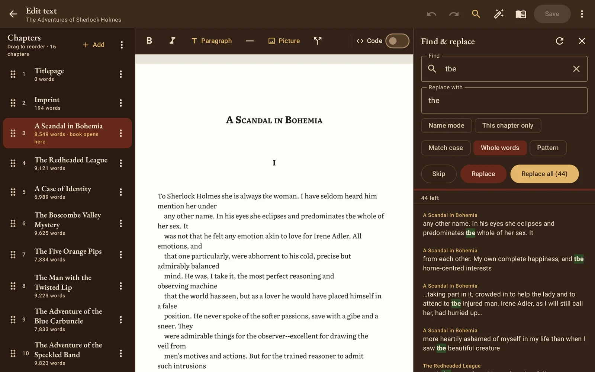
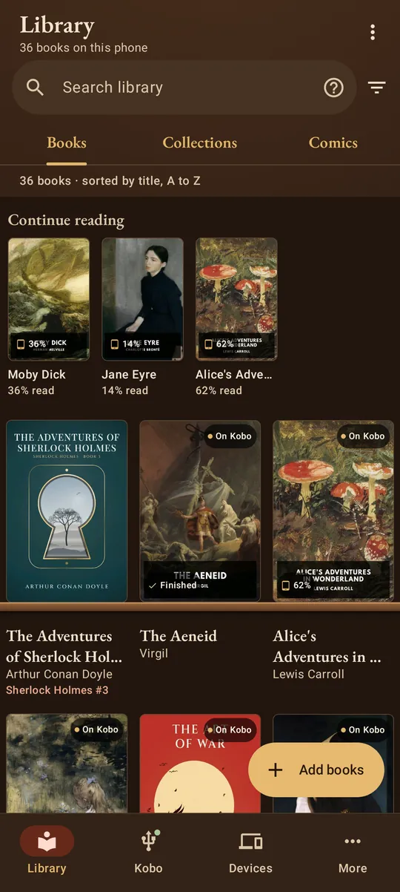
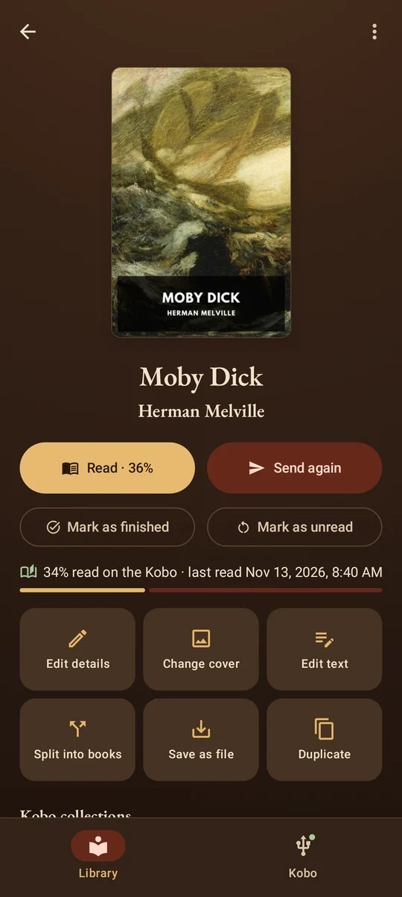
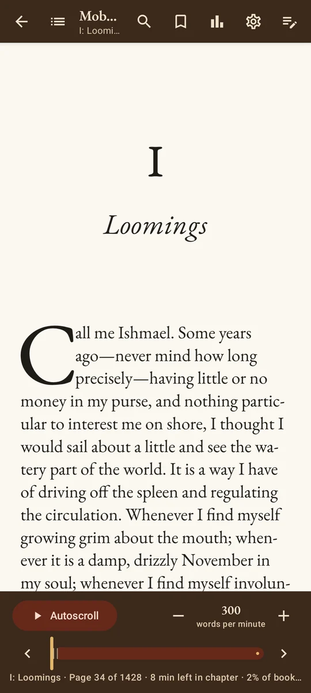

  

<h1 align="center">KoLib</h1>

  <b>An ebook library and Kobo manager for Android.</b> 
  Organise your books, send them to your Kobo, read them and edit them.

  
  
  
  

  

## Download

Get the latest APK from [Releases](https://github.com/Talilard1/KoLib/releases/latest).

| File | Best for |
|---|---|
| **KoLib-…-arm64-v8a.apk** | **Almost every phone and tablet from the last several years** |
| KoLib-…-armeabi-v7a.apk | Older 32-bit phones and tablets |
| KoLib-…-x86_64.apk | Chromebooks, and Android emulators on a PC |
| KoLib-…-x86.apk | Older emulators |
| KoLib-…-universal.apk | If you are uncertain |

*Requires Android 10 or higher. Sending over USB needs a USB-C data cable. The AI runs on 64-bit devices
(arm64-v8a and x86_64); on others, you can use a server of your own.*

## Features

### Your library

- Keep all your books in one place: EPUB, kepub, PDF, MOBI, AZW3, FB2, Word, OpenDocument, RTF, plain
  text, Markdown and HTML, plus CBZ, CBR and CB7 comics.
- Edit titles, authors, series, tags and covers. Find a cover online, or make one from 123 designs in
  43 colour schemes.
- Convert Word, PDF, MOBI, FB2, text and comic files to EPUB, and turn scanned PDFs into text, all on
  your device.
- Edit a book's text: find and replace, chapter tools, clean-ups, and splitting or combining books.
- Keep your phone and tablet in sync over Wi-Fi, including where you're up to in each book. Pair them
  by scanning a QR code, and send what you've copied from one to the other.
- Reading stats, including the reading time your Kobo has recorded.

### Your Kobo

- Send books over USB as kepub or EPUB, straight into your Kobo collections, with covers sized for its
  screen.
- No cable to hand? Send them over Wi-Fi through the Kobo's web browser.
- Got more than one Kobo? Each keeps its own books and collections, and you can switch between them.

### Reading

- Set the reader up your way: fonts (including your own), page colours, paged or scrolling, two pages
  side by side, a print-style layout, highlights, notes, bookmarks and autoscroll.
- Give a book its own settings, and keep different ones for portrait and landscape. Turn your device
  and the reader switches over. The clock, battery and page headings stay clear of the camera hole.
- Look up a word without leaving the page: a small card shows its dictionary entry, with Google,
  Wikipedia and your dictionary apps a tap away.
- A comic reader based on [Mihon](https://github.com/mihonapp/mihon)'s.

### An AI reading companion (optional)

- It runs on your phone or tablet, with no account. Nothing you read leaves your device unless you choose
  to use a server of your own.
- Get a summary of the chapter, or ask questions about the book. It only uses what you've read so far,
  so it won't spoil what's coming.
- Ask about the page you're on, or select some words and tap **Ask AI**. When you look up a word, it
  tells you what it means, and what it means in the sentence you're reading.
- Chat with it from the main page too. It knows what's in your library, and your chats are saved so
  you can come back to them. Hold a message to copy it, or to edit it and ask again.
- Book notes, if you want them: it writes a short note on each chapter you finish, so it remembers the
  whole book, not just the last few pages. You can have it do this only while your device is charging.
- The chat opens in its own window. Drag it anywhere, make it full screen, or shrink it into a bubble.
  It keeps working while it's closed and lets you know when an answer's ready.
- Choose who your AI is: a robot, an anime woman, a cat, an owl or a ghost. Or draw your own character
  on a character sheet. Each has its own personality and a name you can change.
- Your character shows what the AI is doing: reading, thinking, writing, and cheering when an answer's
  ready. Pick it up, shake it, fling it or bump it into the edge of the screen and it reacts. Leave it
  alone and it nods off.
- Change what the AI is told, save it as a preset, and switch presets from the chat. Each character
  remembers the instructions you last gave it.
- KoLib suggests the models that suit your device best, and can have one ready as soon as it opens. You
  can also search Hugging Face for other models, add your own, or use a server of your own.
- In the text editor, it can fix spelling, tidy formatting, rewrite what you select or carry on writing.
  It shows you its changes first.

### And also

- Updates from inside the app: KoLib tells you when there's a new version, shows you what's new, and
  downloads and installs it for you.
- A guided setup for the reader, and a tour of the text editor, the first time you open them.
- 14 themes: warm paper, dark, OLED black, two bookcases, clean light and dark, a manuscript, romance,
  cinema, a terminal, and three for science fiction.
- English, Français, Deutsch, Español, Italiano, Nederlands, Português (Brasil), Русский and 日本語.
- No account, no ads, no tracking.

## Screenshots

<table>
  <tr>
    <td align="center" width="50%"> <b>Books on your Kobo</b></td>
    <td align="center" width="50%"> <b>Collections</b></td>
  </tr>
  <tr>
    <td align="center" width="50%"> <b>Send to Kobo</b></td>
    <td align="center" width="50%"> <b>Edit details</b></td>
  </tr>
  <tr>
    <td align="center" width="50%"> <b>Change a cover</b></td>
    <td align="center" width="50%"> <b>Cover generator</b></td>
  </tr>
  <tr>
    <td align="center" width="50%"> <b>Reader</b></td>
    <td align="center" width="50%"> <b>Reader settings</b></td>
  </tr>
  <tr>
    <td align="center" width="50%"> <b>Text editor</b></td>
    <td align="center" width="50%"> <b>Light theme</b></td>
  </tr>
</table>

<table>
  <tr>
    <td align="center" width="33%"> <b>Library</b></td>
    <td align="center" width="33%"> <b>Book details</b></td>
    <td align="center" width="33%"> <b>Kobo</b></td>
  </tr>
  <tr>
    <td align="center" width="33%"> <b>Send to Kobo</b></td>
    <td align="center" width="33%"> <b>Reader</b></td>
    <td align="center" width="33%"> <b>Cover generator</b></td>
  </tr>
</table>

## Connecting a Kobo

1. Plug the Kobo into your phone or tablet with a USB-C data cable.
2. Tap **Connect** on the Kobo.
3. The first time, Android asks which folder KoLib may use. Tap **Use this folder**, then **Allow**.

When you're done, tap **Eject** in KoLib and unmount the Kobo before unplugging it.

KoLib can't create collections on a Kobo. Create them on the Kobo first
(My Books → Collections → New collection).

Tested with a Kobo Clara 2E. Other Kobo e-readers store books the same way and should work.

## Privacy

Your books stay on your devices and your Kobo. KoLib only goes online to search for covers, to look
a word up in Wiktionary, to download OCR language data or an AI model when you ask for one, to
search Hugging Face when you look for a model, and to ask GitHub once a day whether there's a new
version. You can turn that check off in Settings.

AI models run on your device: nothing you read is sent anywhere. If you use a server of your own
instead, what the AI needs to answer is sent to that server: the words you look up, the pages you ask
about, and your book list when you ask about your library.

The camera is used only to scan a pairing QR code.

## Reporting a problem

Open an [issue](https://github.com/Talilard1/KoLib/issues), say which Kobo and device you have, and
attach the log (Kobo → Device → Open log).

## Credits

- [Mihon](https://github.com/mihonapp/mihon): the comic reader is modelled on Mihon's.
- [kepubify](https://github.com/pgaskin/kepubify): kepub conversion follows its method.
- [libarchive](https://www.libarchive.org/) and [libarchive-android](https://github.com/zhanghai/libarchive-android):
  CBR and CB7 comics.
- [Tesseract](https://github.com/tesseract-ocr/tesseract) and [Tesseract4Android](https://github.com/adaptech-cz/Tesseract4Android):
  OCR.
- [llama.cpp](https://github.com/ggml-org/llama.cpp): runs AI models on the device. The models
  offered are Gemma 4 (Google) and Qwen3.5 (Alibaba), downloaded from Hugging Face.
- [Wiktionary](https://en.wiktionary.org/): dictionary entries.
- [ZXing](https://github.com/zxing/zxing) and [CameraX](https://developer.android.com/media/camera/camerax): QR codes
  for pairing devices.

Fonts and all licences are listed in [NOTICE.md](NOTICE.md).

## Building

See [docs/BUILDING.md](docs/BUILDING.md).

## Licence

KoLib is free software under the GNU General Public License, version 3 ([LICENSE](LICENSE)).

Kobo is a trademark of Rakuten Kobo Inc. KoLib isn't made by, endorsed by or connected with
Rakuten Kobo. The books in the screenshots are public domain, with covers made from public-domain paintings.
