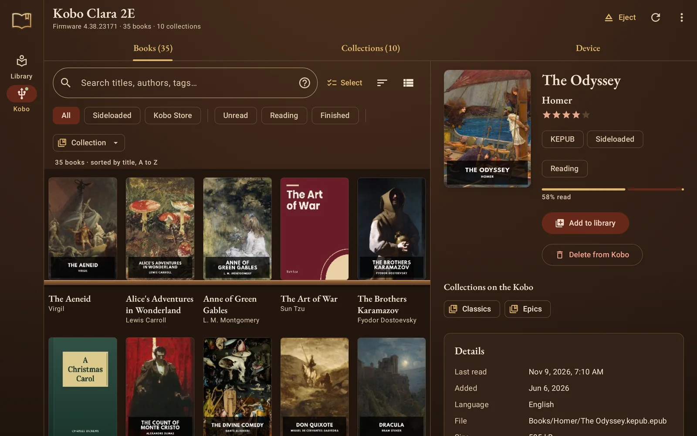
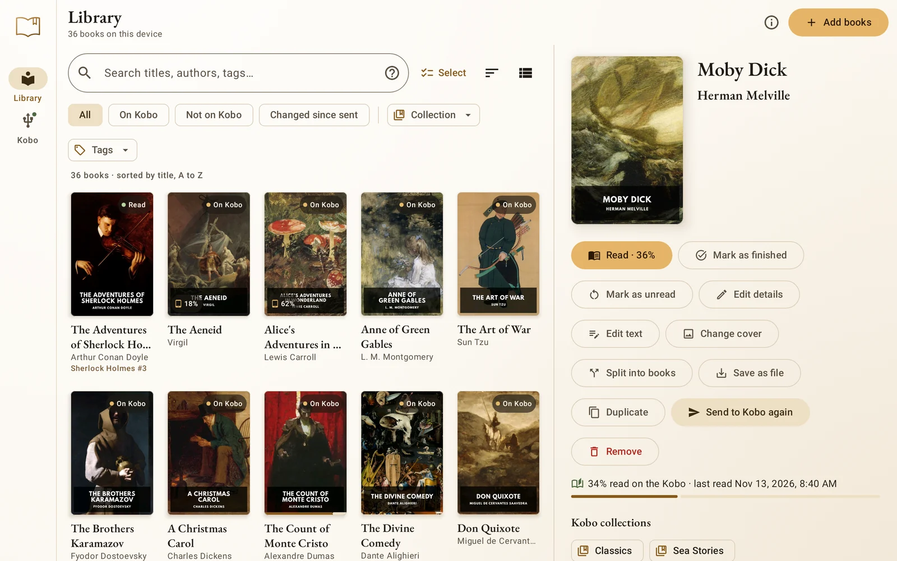
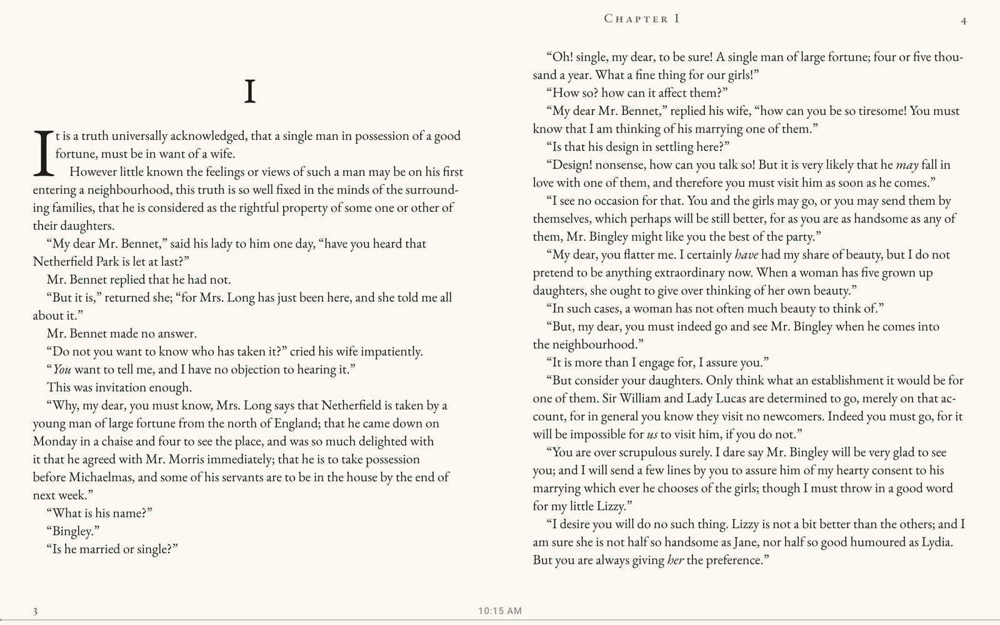
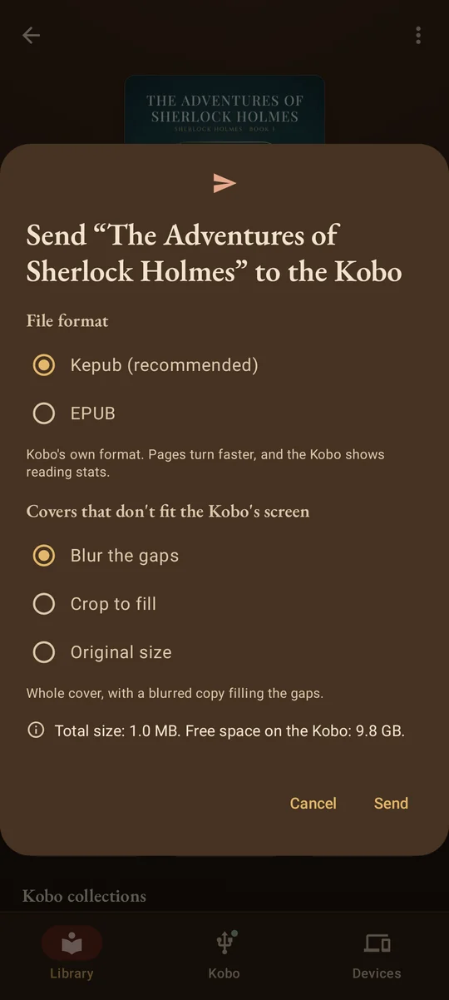

<p align="center">
  
</p>

<h1 align="center">KoLib</h1>

<p align="center">
  <b>Your Kobo's library, on your Android tablet or phone.</b>
</p>

<p align="center">
  
  
  
  
</p>

<p align="center">
  
</p>

## What it does

Plug your Kobo into your tablet or phone with a USB-C cable and KoLib reads its books and
collections. Keep your books in KoLib, fix their details and covers, read them, and send them to
the Kobo as kepubs, the Kobo's own format, so pages turn quickly and the Kobo keeps reading stats.

| Library | Kobo | Reader |
|---|---|---|
| Add EPUB, PDF, MOBI, Word and other ebook files, or a whole folder at once. Edit titles, authors, series, tags, descriptions and covers. | See what's on your Kobo, put books into its collections, send books and keep backups of its database. | Read in KoLib too, with your own typeface, margins and page colour, highlights, notes and bookmarks. |

## On a tablet

| | |
|:---:|:---:|
| <a href="docs/images/tablet-kobo-books.webp"></a><br>**The books on your Kobo** | <a href="docs/images/tablet-kobo-collections.webp"></a><br>**Its collections** |
| <a href="docs/images/tablet-send.webp"></a><br>**Sending a book** | <a href="docs/images/tablet-details.webp"></a><br>**Editing its details** |
| <a href="docs/images/tablet-cover.webp"></a><br>**Changing a cover** | <a href="docs/images/tablet-make-cover.webp"></a><br>**Making a new one** |
| <a href="docs/images/tablet-editor.webp"></a><br>**Editing the text** | <a href="docs/images/tablet-library-light.webp"></a><br>**The light look** |

<p align="center">
  <a href="docs/images/tablet-reader.webp"></a><br>
  <b>Reading, two pages at a time in landscape</b>
</p>

## On a phone

| | | |
|:---:|:---:|:---:|
| <br>**Library** | <br>**A book's page** | <br>**Your Kobo** |
| <br>**Sending** | <br>**Reading** | <br>**Making a cover** |

## Highlights

- **Sends books the way the Kobo likes them:** as kepubs (or plain EPUB if you'd rather), with the
  cover fitted to the Kobo's screen. A book you send again is updated on the Kobo, not added twice.
- **Any ebook file:** EPUB, kepub, PDF, MOBI, AZW and AZW3, FB2, Word (.docx), OpenDocument (.odt),
  RTF, plain text, Markdown, HTML and CBZ. Everything is made into an EPUB you can edit, and the
  file you added is kept. A PDF can still go to the Kobo as a PDF.
- **The Kobo's collections:** KoLib reads them, and puts books into them when you send or edit.
  It can't make new collections on the Kobo, so make one there first (My Books → Collections →
  New collection) and KoLib can then add books to it.
- **Covers:** look one up on Amazon, Google Books and Open Library, or on Google Images, with each
  picture's size shown on it. Or make a cover with the title, in one of several designs.
- **Edit the text, not only the details:** fix typos, find and replace (with a mode for renaming a
  character), tidy up blank lines, quotes and dashes, rename, split or join chapters, split an
  omnibus into books or combine books into one.
- **A reader of its own:** turn pages or scroll, two pages side by side, page headings like a
  printed book, highlights and notes, bookmarks, autoscroll, and looking words up in your
  dictionary app.
- **Backups:** each time you connect and the Kobo's database has changed, KoLib saves a zipped copy
  of it on your device before it changes anything.
- **In your language:** English, Français, Deutsch, Español, Italiano, Nederlands,
  Português (Brasil) and 日本語. KoLib follows your device's language, or pick one in its settings.
- **Nothing to sign up for:** no account and no ads. KoLib only goes online when you look for a
  cover or look a word up.

## Install

1. Download the APK for your device from [Releases](../../releases/latest). Not sure which?
   Take **arm64-v8a**, or the universal one.
2. Open it, and allow installing apps from that source if Android asks.
3. Open KoLib. A short tour sets the language, finds your books and shows how to connect your Kobo.

| File | Best for |
|---|---|
| **KoLib-1.0-arm64-v8a.apk** | **Almost every phone and tablet from the last several years** (Galaxy Tab S9, Galaxy A72…) |
| KoLib-1.0-armeabi-v7a.apk | Older 32-bit phones and tablets |
| KoLib-1.0-x86_64.apk | Chromebooks and Android emulators on a PC |
| KoLib-1.0-x86.apk | Older emulators |
| KoLib-1.0-universal.apk | Any of these, if you'd rather not choose |

Needs Android 10 or newer, and a USB-C cable (or adapter) that carries data, not only power.
Updates install over the version you have; your library and settings stay.

## Connecting your Kobo

1. Plug the Kobo into your phone or tablet with the cable.
2. On the Kobo's screen, tap **Connect**.
3. The first time only, Android asks which folder KoLib may use: it opens on the Kobo's drive, so
   tap **Use this folder**, then **Allow**.

When you're done, eject the Kobo before unplugging it: KoLib shows you where Android's **Unmount**
option is. Once it's unplugged, the Kobo adds the books you sent to its library.

KoLib was made with a Kobo Clara 2E, a Galaxy Tab S9 and a Galaxy A72. Other Kobo e-readers keep
their books the same way, so they should work too.

## Something wrong?

KoLib keeps a log of what it does (Kobo → Device → Open log). Share the log when you
[report a problem](../../issues), and say which Kobo and device you have.

<details>
<summary><b>Building from source</b></summary>

### Requirements

- JDK 17 or newer
- The Android SDK with platform 36 (the Gradle wrapper fetches the right Gradle)

### Build and test

```
./gradlew assembleDebug            # app/build/outputs/apk/debug/
./gradlew assembleRelease          # app/build/outputs/apk/release/: one APK per processor type, and a universal one
./gradlew :app:testDebugUnitTest   # tests; screenshots go to app/build/outputs/roborazzi/
```

### The signing key

The key that signs release builds is **not** in this repository, and must never be added to it:
anyone with the key could make APKs that install over KoLib as if they were updates.

Without the key, `assembleRelease` makes unsigned APKs. To make signed builds that update the
installed app, put these two files in a `keystore/` folder at the top of the project (git ignores
that folder):

- `release.jks`, the key itself
- `keystore.properties`:

  ```
  storeFile=release.jks
  storePassword=...
  keyAlias=...
  keyPassword=...
  ```

Keep a copy of both somewhere safe. If the key is lost, new builds can't update the installed app.

### Translations

All the app's text goes through `tr("...")`, with a table for each language in
`app/src/main/assets/i18n/`. How to add or change text, and the translations themselves, are in
[tools/i18n](tools/i18n/README.md).

### Project map

| Where | What |
|---|---|
| `app/src/main/java/dev/kobolibrary/app/kobo/` | The Kobo: reading its database, sending books, collections, backups of its database |
| `…/library/` | KoLib's own library: books, covers, folders of books |
| `…/epub/` | Reading, checking and editing EPUBs, and making kepubs |
| `…/convert/` | Turning PDF, MOBI, Word and other files into EPUBs |
| `…/reader/` | The reader: pages, settings, highlights |
| `…/covers/` | Looking covers up online |
| `…/ui/` | The screens |
| `app/src/main/assets/reader/` | The reader's page code (`reader.js`, `reader.css`) |
| `app/src/test/` | Tests, including screenshots of every screen |
| `tools/i18n/` | Translations |
| `tools/opening-sound/` | Makes the opening sound, `app/src/main/res/raw/kolib_opening.ogg` |

</details>

## Licences

No licence has been chosen for KoLib's own code yet, so it isn't open source for now. The parts
that come from elsewhere (fonts, the kepub method, Android libraries) and their licences are listed
in [NOTICE.md](NOTICE.md).

Kobo is a trademark of Rakuten Kobo Inc. KoLib isn't made by, endorsed by or connected with
Rakuten Kobo. The books in the pictures are public domain, with covers made from public-domain
paintings.
